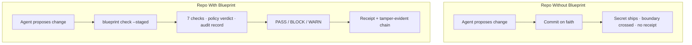

<div align="center">

# blueprint

### The change-governance firewall for AI-agent-driven repos

**Check · Fix · CI · Audit · Approve — a local-first governance layer on top of [kern](https://github.com/JayveerPrajapati/kern).**

[](LICENSE)
[](https://go.dev/)
[](#telemetry--privacy)
[](#telemetry--privacy)
[](#what-it-checks)
[](#what-it-checks)
[](#mcp-tools)
[](#evidence--gates)

**7 checks · 4 enforcement surfaces · 4 MCP tools · 14 CLI commands · 100% local**

[**Quickstart**](#quickstart) •
[**Why Blueprint?**](#the-problem-the-ai-agent-change-crisis) •
[**What It Checks**](#what-it-checks) •
[**Evidence & Gates**](#evidence--gates) •
[**CLI Reference**](#cli-reference) •
[**MCP Tools**](#mcp-tools) •
[**Enforcement**](#enforcement-layers) •
[**Install**](#install) •
[**Configuration**](#configuration) •
[**Docs**](#documentation)

</div>

---

## The Problem: The AI-Agent Change Crisis

AI agents generate code at machine speed — and a repo that accepts every
change on faith collects secrets, boundary violations, and unreviewable
merges. The failure is not detection: gitleaks (150+ secret types), jscpd
(223 languages), and kern's index already beat any hand-rolled scanner on
coverage. The failure is that **nobody owns the decision**.

Without a governance layer, every change enters on trust:

1. **Secrets leak** — a hardcoded API key in a generated file ships because
   nothing looked before the commit.
2. **Architecture drifts** — a generated import crosses a forbidden boundary
   and the layering contract silently erodes.
3. **Duplication compounds** — machine-generated near-copies of functions
   accumulate faster than review can see them.
4. **Nothing is provable** — there is no receipt that a change was validated,
   and no audit chain that survives tampering.

Blueprint is the **governance layer** between a change and its merge. It runs
detection, decides policy, keeps tamper-evident receipts, and demands human
approval for high-risk agent changes — all locally, with zero telemetry.



---

## Ungoverned Repo vs. Blueprint-Governed Repo

| Dimension | Ungoverned (`git commit --allow-anything`) | Blueprint-Governed |
|---|---|---|
| **Secrets** | Detected after the leak ships | **Blocked at the hook**: gitleaks + in-house secscan, never a silent pass |
| **Architecture** | Boundary rule erodes invisibly | **`kern guard` verdict on every change** — `.kern/boundaries.json` is enforced, not aspirational |
| **Duplication** | Near-copies accumulate | **Two-pass triage**: in-house similarity (≥0.60 advisory) + jscpd confirmation (BLOCK) |
| **Proof** | "Trust me, I ran the checks" | **Tamper-evident receipts**: `blueprint ci` seals, `blueprint verify-receipt` proves |
| **High-risk changes** | Agent self-approves | **Two-person rule**: `request-approval` → `approve` → re-run with `--approval-id` |
| **Agent identity** | Anyone can change anything | **Authorization**: agent/task-scoped verdict at every surface |
| **Telemetry** | Unknown | **Zero** — everything stays in `.blueprint/` and `.kern/` in your repo |

> **Evidence discipline.** Claims in this README are testable: the G0–G29 gate
> registry ([`docs/gates.md`](docs/gates.md)) is the authoritative source of
> truth for what each gate verifies and which test file enforces it; the
> duplication triage model is measured in
> [`docs/duplication-benchmark.md`](docs/duplication-benchmark.md). The
> full suite runs 29 packages and every gate against the real kern binary in
> CI (`KERN_REQUIRE_BINARY=1` — a missing binary FAILs, never silently skips).

---

## Quickstart

```sh
# 1. Install the CLI (Go 1.27+)
go install github.com/JayveerPrajapati/blueprint/cmd/blueprint@latest

# 2. Preflight your environment (kern + git + config)
blueprint doctor

# 3. Validate staged changes against policy
cd your-project && git add . && blueprint check --staged

# 4. Enforce on every commit (optional but recommended)
blueprint install hook
```

Exit code `0` = PASS, `1` = BLOCK, `2` = ERROR — see the [exit-code table](#exit-codes).

## Why Blueprint?

Detection is a commodity — gitleaks (150+ secret types), jscpd (223
languages), and kern's index beat a hand-rolled scanner on coverage.
Blueprint's value is the layer above:

- **Orchestration** — one pipeline, one set of structured findings, enforced
  at every surface (pre-commit, MCP, CI, watcher). Detection is delegated;
  the decision is centralized.
- **Provenance** — every verdict carries `rule_id`, `severity`, `file`,
  `line`, `evidence`, and a suggested fix. Never raw text. Always redacted.
- **Repair** — the `blueprint_repair_guidance` MCP tool returns a structured
  repair contract so agents fix findings programmatically, not by guessing.
  See [docs/agent-repair-loop.md](docs/agent-repair-loop.md).
- **Audit** — every validation writes a self-hashed record, best-effort
  linked into kern's tamper-evident hash chain. Tampering with any record
  breaks the chain.
- **Approval** — high-risk agent changes gate behind a two-person rule:
  `request-approval` → `approve` → re-run with `--approval-id`.

Blueprint does **not** reimplement code intelligence. It reuses kern's index,
call graph, `kern guard`, and `kern sec`, and adds the governance layer on
top. Every change runs through the same policy pipeline. Beyond detection,
two governance gates are enforced at every surface: **agent authorization**
(who may change) and the **two-person approval** rule.

## What It Checks

| Check | Category | Source of truth | Default | Posture |
|---|---|---|---|---|
| **Architecture boundaries** | `architecture` | `.kern/boundaries.json` via `kern guard` | **block** | Enforced; WARN if `.kern/` missing |
| **Agent authorization** | `authz` | kern `authz_verdict` (contract v2) | **block** | Unauthorized agent identities blocked |
| **Hardcoded secrets** | `secrets` | gitleaks (primary) · in-house secscan (fallback) | **block** | Never a silent pass — the fallback scans for real |
| **Structural duplication** | `duplication` | jscpd (primary) · in-house advisory (fallback) | **warn** | Advisory; jscpd-confirmed pairs escalate to BLOCK |
| **Sandbox build/test** | `tests` | `go build ./...` + `go test ./...` in isolated worktree | **block** | Opt-in (`--tests`); network-isolated (Linux) |
| **Resilience scenarios** | `resilience` | chaos scenarios (Go ecosystem) | **warn** | Opt-in (`--resilience`) |
| **Two-person approval** | `approval` | risk classifier + JSONL approval store | **block** | High-risk agent changes block until approved |

## Evidence & Gates

Blueprint's test harness is the **G0–G29 gate registry** ([`docs/gates.md`](docs/gates.md)):
30 gates, each with an id, a "verifies" contract, an enforcement level, and
the test file that pins it. The gates run against the **real kern binary** —
integration tests that exercise the actual `kern guard` / `kern sec` /
`kern fingerprint` contract, not mocks.

Measured properties, reproduced in CI on every commit:

- **The secrets gate never goes quiet.** With neither gitleaks nor the kern
  binary available, the built-in secscan core still detects a hardcoded
  secret and BLOCKS — pinned by `TestGitleaksFallbackNoClientScans`.
- **Duplication triage is two-pass.** In-house structural similarity
  (signature/params/control-flow/called-symbols/size, ≥0.60 advisory) plus
  jscpd token-level confirmation — a block-eligible candidate whose file pair
  is jscpd-confirmed escalates to BLOCK. Methodology and numbers in
  [`docs/duplication-benchmark.md`](docs/duplication-benchmark.md).
- **29 packages, all green** against the restored kern bridge
  (`guard`/`sec`/`fingerprint`/`audit` — the binary contract blueprint's
  adapters consume).

## How It Works

```text
        ┌─────────────────────────────────────┐
        │  AI Agent · IDE · Human             │
        └──────────────────┬──────────────────┘
                           │
        MCP · CLI · Git hook · CI
                           │
                  Blueprint Pipeline
                           │
        architecture      kern guard
        secrets           gitleaks
        duplication       jscpd
        sandbox           go test
        resilience        chaos
                           │
                 PASS / BLOCK / WARN
                 structured · audited
                           │
        ┌──────────────────▼──────────────────┐
        │  .blueprint/audit  (hash chain)     │
        │  .blueprint/receipts (P1.4 seals)   │
        │  .blueprint/metrics.json (local)    │
        └─────────────────────────────────────┘
```

Every validation appends a self-hashed record to the local audit chain and,
best-effort, links it into kern's tamper-evident chain. `blueprint ci` seals
a **receipt** for PASS/WARN runs — the merge-time evidence that a PR was
actually validated, verifiable later with `blueprint verify-receipt`.

## CLI Reference

| Command | Flags | Purpose |
|---|---|---|
| `blueprint version` | — | Print the version |
| `blueprint doctor` | `--repo DIR` `--json` | Preflight environment / configuration diagnostic |
| `blueprint check` | `--staged` `--all` `--fast` `--ci` `--format=terminal\|json` `--json` `--repo DIR` `--source agent\|ide\|human\|refactor\|dep-bot\|ci` `--resilience` `--tests` `--isolate-network` `--allow-unisolated` `--require-kern` `--approval-id ID` `--intent TEXT` `--agent-id ID` `--task TEXT` | Validate staged changes against policy |
| `blueprint fix` | `--repo DIR` `--file FILE` (repeat) `--content STR` (repeat) `--json` | Validate agent-proposed fixes in an isolated worktree |
| `blueprint install hook` | — | Install a pre-commit hook (thin adapter) |
| `blueprint watch` | `--repo DIR` `--strict` `--policy architecture,secrets` `--interval DURATION` `--debounce DURATION` | Continuous advisory file-change watcher |
| `blueprint ci` | `--repo DIR` `--base REF` `--head REF` `--artifact-file FILE` `--json` `--no-human` `--strict-latency` `--no-cache` `--receipt` | Validate base..head diff (CI / protected branch); writes a JSON artifact + receipt |
| `blueprint verify-receipt` | `--repo DIR` `--receipt-id ID` `--json` `--sarif` `--in-toto` `--check-diff` | Verify a tamper-evident CI receipt (receipt + audit chain) |
| `blueprint metrics` | `--repo DIR` `--json` `--reset` | Show local validation metrics (no cloud telemetry) |
| `blueprint graph` | `--repo DIR` `--format mermaid\|dot\|json` `--output FILE` | Print the architectural boundary graph for the repo |
| `blueprint request-approval` | `--repo DIR` `--intent TEXT` (required) `--source SRC` `--files LIST` `--requester WHO` | Request human approval for a high-risk change (two-person rule) |
| `blueprint approve` | `<id>` `--repo DIR` `--reason TEXT` `--approver WHO` | Approve a pending approval request |
| `blueprint reject` | `<id>` `--repo DIR` `--reason TEXT` `--approver WHO` | Reject a pending approval request |
| `blueprint help` | — | Show help |

`blueprint check` defaults to staged changes; `--fast` skips the jscpd
two-pass duplication scan (advisory in-house findings only) for quick local
runs — CI runs the full scan. `blueprint graph` renders the boundary rules
from `.kern/boundaries.json` as Mermaid, Graphviz DOT, or JSON, so
architecture policy is reviewable, not just enforced.

## Exit Codes

The thin `main` dispatcher has its own small contract on top of the spec's:

- **bare invocation** (`blueprint`) prints usage to stderr and exits **0**
- **unknown command** (`blueprint nonsense`) prints usage and exits **2**
- `--help` / `-h` prints usage and exits **0**

Spec Section 6 exit codes:

| Code | Meaning |
|---|---|
| `0` | PASS — no BLOCK or WARN findings |
| `1` | BLOCK — policy violation. `blueprint fix` exits 1 while ANY finding — WARN or BLOCK — remains; the repair loop must iterate |
| `2` | ERROR — tool / runtime / configuration / usage error |
| `3` | Invalid Blueprint configuration, or receipt not found |
| `4` | Unsupported operation or environment |

## MCP Tools

When running as an MCP server (`blueprint-mcp`), Blueprint exposes **4
governance-aware tools**:

| Tool | Purpose |
|---|---|
| `blueprint_validate_staged` | Validate staged git changes against policy. Returns structured `ValidationResult`. |
| `blueprint_validate_proposed` | Validate proposed file content (not yet on disk) against policy. |
| `blueprint_explain_finding` | Explain a finding in plain language with remediation guidance. |
| `blueprint_repair_guidance` | Return a structured repair contract so agents fix findings programmatically. |

Blueprint's MCP server is **governance-aware and auditable** — not just
another code MCP. Three properties set it apart:

- **Governance-aware** — returns structured findings (`rule_id`, `severity`,
  `evidence`, `suggested_fix`), never raw text. BLOCK/WARN policy is enforced
  at the tool boundary.
- **Auditable** — every validation writes a self-hashed record, best-effort
  linked into kern's tamper-evident hash chain.
- **Sandboxed** — CI runs in an isolated git worktree; the pre-commit hook
  runs locally with no network access to external services.

## Enforcement Layers

Blueprint enforces at four surfaces. Three are binding; the watcher is
advisory.

| Layer | Command / tool | Enforces |
|---|---|---|
| **Pre-commit hook** | `blueprint install hook` | runs `blueprint check --staged` on every commit |
| **MCP (agents)** | `blueprint_validate_staged`, `blueprint_validate_proposed`, `blueprint_explain_finding` | voluntary validation before writes |
| **CI / protected branch** | `blueprint ci --base main --head HEAD` | base..head diff validation, JSON artifact + receipt |
| **Watcher** | `blueprint watch` | continuous advisory feedback |

The enforcement chain is **hook + CI + protected branch**. The local hook can
be bypassed with `git commit --no-verify` — this is documented and expected,
not a bug. CI and branch protection are what make enforcement organizational:
`blueprint ci` seals a receipt for every PASS/WARN run, and
`blueprint verify-receipt` makes that receipt a merge requirement that
`--no-verify` cannot bypass.

## Install

**Prerequisites** — kern (Blueprint requires **>= v0.9.0**; it auto-installs
the latest kern when none is found, and shows a clear upgrade message when
the installed one is too old) and git (a git repository is required —
Blueprint validates changes).

**Standard install** (Go 1.27+):

```sh
go install github.com/JayveerPrajapati/blueprint/cmd/blueprint@latest
go install github.com/JayveerPrajapati/blueprint/cmd/blueprint-mcp@latest
```

<details>
<summary><b>Other install methods</b></summary>

| Method | Command | Notes |
|---|---|---|
| **build locally** | `make build` | → `bin/blueprint`, `bin/blueprint-mcp`; version injection via ldflags |
| **go build** | `go build -o blueprint ./cmd/blueprint` | Plain build, prints `dev` version |
| **CI / release** | GoReleaser (`.goreleaser.yaml`) | Cross-compiled tarballs; version injected into `internal/bpreceipt/version` |

</details>

Blueprint resolves the kern binary in this order: `$KERN_BINARY` → `$PATH` →
`../kern/bin/kern` relative to the working directory.

### Wire the MCP server (optional, for agents)

**Claude Code:**

```sh
claude mcp add blueprint -- blueprint-mcp
```

**Cursor / VS Code** — add to your project's `.mcp.json`:

```json
{
  "mcpServers": {
    "blueprint": { "command": "blueprint-mcp", "args": [] }
  }
}
```

### Set architecture boundaries (optional, recommended)

```sh
cat > .kern/boundaries.json <<'EOF'
{
  "rules": [
    { "from": "frontend", "to": "db",     "action": "forbid" },
    { "from": "frontend", "to": "backend", "action": "forbid" }
  ]
}
EOF
```

## Configuration

Blueprint reads an **optional** `.blueprint/config.yaml`. If absent,
conservative defaults apply. If present but invalid, it fails with exit code
`3`.

```yaml
# .blueprint/config.yaml
version: 1
mode: enforce                # enforce | warn | off
policies:
  architecture: block
  secrets:      block
  duplication:  warn
  tests:        block
sources:
  agent:
    duplication: warn        # override per-source (spec P0-3)
execution:
  timeout_seconds: 300
  max_output_bytes: 1048576
feedback:
  format: json
  include_suggestions: true
approval:
  enabled: true
  require_for_sources: [agent]
  require_for_risk_levels: [high]
  sensitive_paths: [".kern/**", "*.pem", "*.key"]
```

## Telemetry & Privacy

Blueprint collects **zero telemetry**. No network calls, no analytics, no
phoning home. All validation runs locally. The only network activity is
`go install` fetching modules (standard Go module proxy). Audit chains,
receipts, and metrics all live under `.blueprint/` in your repository.

## Supported Platforms

Any platform with Go 1.27+: `go install` or build from source.

### GitHub Actions

Protect your `main` branch without any local setup — the action installs
blueprint, kern, and gitleaks on the runner, then gates every pull request:

```yaml
- uses: JayveerPrajapati/blueprint/.github/actions/blueprint-ci@v0.1.0
  with:
    blueprint-ref: main    # or a pinned tag
    kern-ref: main         # or a pinned tag
```

The action runs `blueprint ci` and uploads the JSON artifact as a workflow
artifact. Combine with branch protection rules to block merges on BLOCK
results.

## Development

```sh
make build   # → bin/blueprint, bin/blueprint-mcp
go test ./...
```

Version injection:

```sh
go build -ldflags "-X github.com/JayveerPrajapati/blueprint/internal/bpreceipt/version.Version=$(git describe --tags --always --dirty)" \
  -o bin/blueprint ./cmd/blueprint
```

Without ldflags, the version prints `dev`.

### Layout

```text
cmd/blueprint/         Thin CLI dispatcher (check, doctor, fix, install,
                       watch, ci, metrics, graph, verify-receipt, approval)
cmd/blueprint-mcp/     MCP server binary (stdio)
internal/bpcli/cli/    The CLI surface — command implementations
internal/bpcli/mcp/    MCP tool handlers (validate_staged / proposed, explain, repair)
internal/blueprint/    Core: adapters/kern (kern integration), audit (hash chain),
                       domain, sandbox (isolated worktree), service (pipeline), watcher
internal/bppolicy/     Policy engine + risk classifier (approval gating)
internal/bpreceipt/    Receipts (P1.4), local metrics, version, boundary graph
internal/gates/        Approval store + two-person-rule gate
internal/scanners/     gitleaks + jscpd + in-house duplication triage + secscan core
```

## Documentation

- [docs/user-guide.md](docs/user-guide.md) — full walkthrough
- [docs/installation.md](docs/installation.md) — prerequisites and building from source
- [docs/configuration-reference.md](docs/configuration-reference.md) — `.blueprint/config.yaml`
- [docs/policy-reference.md](docs/policy-reference.md) — boundaries, secrets, duplication, suppression
- [docs/findings-format.md](docs/findings-format.md) — the structured finding contract
- [docs/gates.md](docs/gates.md) — the authoritative G0–G29 gate registry
- [docs/mcp-integration-guide.md](docs/mcp-integration-guide.md) — MCP tools for agents
- [docs/agent-repair-loop.md](docs/agent-repair-loop.md) — propose → validate → repair → re-validate
- [docs/git-hook-guide.md](docs/git-hook-guide.md) — pre-commit enforcement
- [docs/ci-guide.md](docs/ci-guide.md) — protected-branch enforcement and CI config
- [docs/security-model.md](docs/security-model.md) — threat model and redaction invariants
- [docs/limitations.md](docs/limitations.md) — honest scope boundaries
- [docs/troubleshooting.md](docs/troubleshooting.md) — common failure modes
- [docs/demo-and-examples.md](docs/demo-and-examples.md) — worked examples
- [docs/duplication-benchmark.md](docs/duplication-benchmark.md) — duplication-check benchmarks

## License

[MIT](LICENSE)